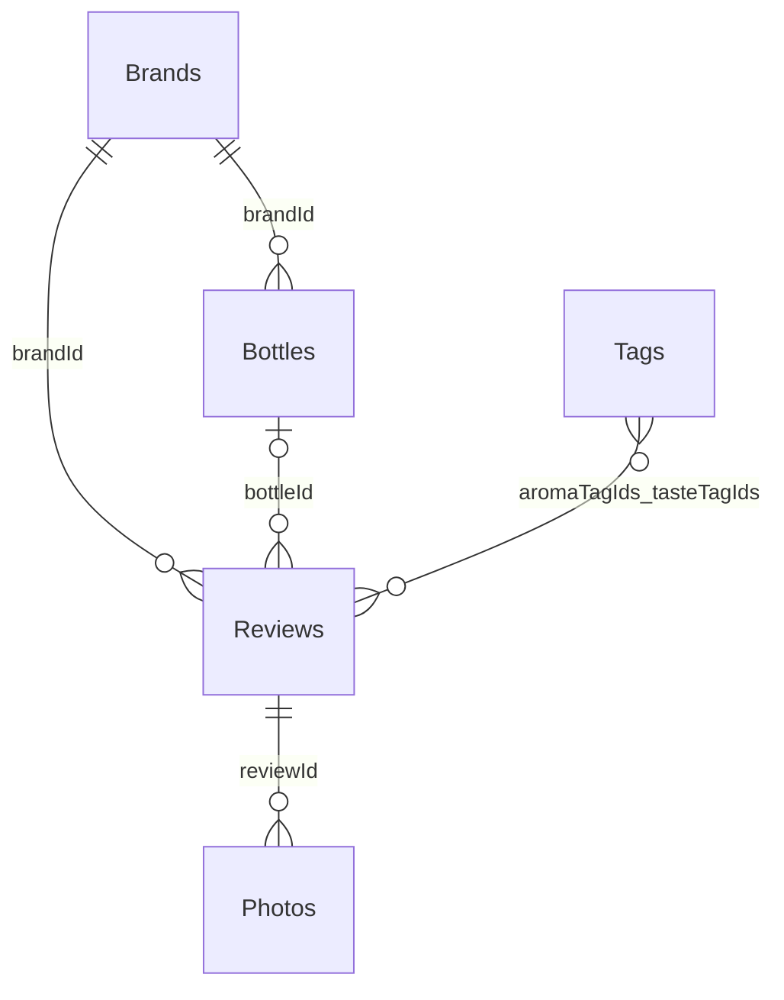

# Sakefolio MVP データモデル v1.0

アプリ本体は AppSheet、ユーザーごとのデータは各自の Google Sheets / Drive が正本。共有するのは空のテンプレート定義と公開銘柄マスターだけです。

## ERD（5テーブル）

- Brands: 銘柄名・酒蔵・産地。さけのわIDまたはユーザー独自IDを持つ。
- Bottles: 銘柄に属する個別商品（純米吟醸・生原酒など）。レビューでの指定は任意。
- Reviews: 飲んだ体験1回につき1レコード。同じ銘柄を何回もレビューできる。
- Photos: 画像1ファイルごとに1レコード。レビューに1対多で関連付ける。
- Tags: 語彙47件の辞書。レビューはEnumListとしてタグIDを複数保持する。

## 主キーと参照先

| テーブル | 主キー | 関連キー | 生成方法 |
|---|---|---|---|
| Brands | brandId | breweryId / areaId（文字列の参考ID） | 公式 `sw-{id}` / 手入力 `manual-{UNIQUEID()}` |
| Bottles | bottleId | brandId (Ref Brands) | `UNIQUEID()` |
| Reviews | reviewId | brandId (Ref Brands), bottleId (Optional Ref Bottles) | `UNIQUEID()` |
| Photos | photoId | reviewId (Ref Reviews, IsPartOf) | `UNIQUEID()` |
| Tags | tagId | なし | 固定ID |

Google Sheets上に物理的な外部キー制約やトランザクションは存在しない。参照整合性はAppSheetのRef/Valid_Ifと、インポートスクリプトのID保持で確保する。

## 主な項目

### Brands
`brandId, brandName, breweryName, prefecture, breweryId, areaId, source, sakenowaBrandId, createdAt, updatedAt`

`source=sakenowa` の公式行は、AppSheetフォーム上での編集を禁止。`manual` は手入力で追加可。取り込み時に手入力レコードは消去しない。

### Bottles
`bottleId, brandId, productName, sakeType, processingStyle, riceVariety, polishingRatio, alcoholPercent, vintage, notes, createdAt, updatedAt`

同一銘柄でも商品違いは別行で管理する。

### Reviews
`reviewId, brandId, bottleId, drinkingDate, rating, aromaTagIds, tasteTagIds, sweetDry, lightRich, acidity, umami, comment, drinkingPlace, priceJPY, createdAt, updatedAt`

`rating` は1〜5の整数で必須。`aromaTagIds` と `tasteTagIds` は辞書TagsのIDリスト。味わい尺度は数値1〜5で未入力（空）を許し、3を既定値にしない。

### Photos
`photoId, reviewId, imageFile, photoType, caption, capturedAt, aiStatus`

`imageFile` はAppSheet Image型。Driveの非公開画像のパスを保存する。写真は表ラベル、裏ラベル、ボトル、料理、その他で分類。`aiStatus` は将来AI対応の拡張ポイントでMVPでは未解析。

### Tags
`tagId, category, tagGroup, tagLabel, displayOrder, isActive`

- `category=aroma`: 果実系、花系、米・穀物系、乳製品系、甘い香り、熟成・その他
- `category=taste`: 口当たり、旨味・コク、清涼感、後味、その他
- 現在は香り26・味わい21、計47語
- ブランド自体のさけのわ6軸フレーバーと、個人の味わい評価を混同しない。

## 権限と配布

各自のアプリ、シート、画像フォルダを独立させる。ユーザーごとにコピーしたAppSheetアプリ間でReviewsとPhotosを同期しない。マスターアプリには実データを保存しない。

AppSheetの「アプリを共有する」と「アプリとデータをコピーさせる」は異なる。家族への配布は後者を使い、コピー後の所有・保存先を検証する。

## 将来のAI拡張

- Photosの元画像を使用して銘柄・蔵元・商品名を抽出する。
- 品質未確認のAI推定値と確定済みの`brandId`を区別する。
- 公式銘柄に該当しない場合もユーザーが手動追加可能にする。
- AIはMVPには実装・課金しない。
